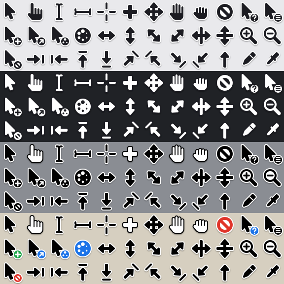

# Meridian

An Xcursor theme for Linux: chunky, rounded graphite shapes with a white edge
and a soft shadow, readable on both light and dark backgrounds. Works on X11
and on Wayland compositors that read Xcursor themes.

Four themes are built from the same drawings:

- `Meridian`: graphite with a white edge
- `Meridian-Light`: white with a graphite edge
- `Meridian-Classic`: black with a white edge, except the hands and the cell
  cross, which are white with a black edge
- `Meridian-Colour`: the classic scheme with a green copy badge, blue link,
  help and busy badges, and red for the two forbidden signs

## Build

Needs Python 3.11+, Pillow and `rsvg-convert` (librsvg2-tools on Fedora,
librsvg2-bin on Debian).

    ./build.py

The themes are written to `dist/` in sizes 24, 32, 36, 48, 64, 72 and 96.

## Install

    ./build.py install

This builds and copies the themes to `~/.local/share/icons`. Then pick one in
the desktop's cursor settings, or on GNOME:

    gsettings set org.gnome.desktop.interface cursor-theme Meridian

## Editing

Each cursor is one file in `svg/`, drawn on a 24x24 canvas so that one unit is
one pixel at the default size. `cursors.toml` holds the hotspot, the legacy
names that symlink to it and, for `wait` and `progress`, the frame count and
delay. The badge cursors (`copy`, `alias`, `help`, `context-menu`, `no-drop`,
`progress`) embed `default.svg`, so a change to the arrow carries over to them.

The other themes are made by replacing or swapping the two colours used in the
drawings, `#1b1c20` and `#fff`, so keep to those two.

`./build.py preview` redraws `preview.png`.

## License

Copyright (C) 2026 sachesi <xsachesi@pm.me>

GPL-3.0-or-later, see [COPYING](COPYING).
